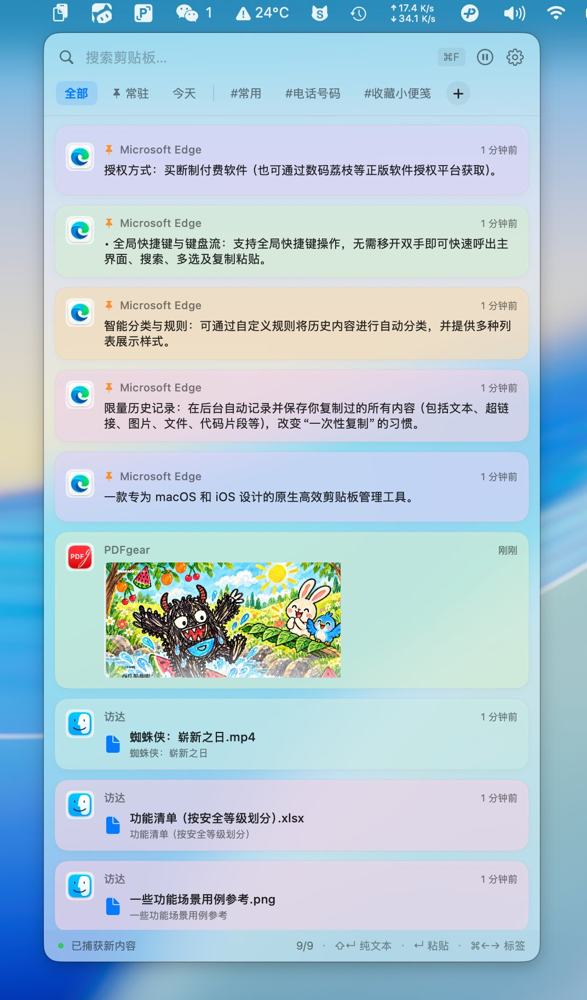
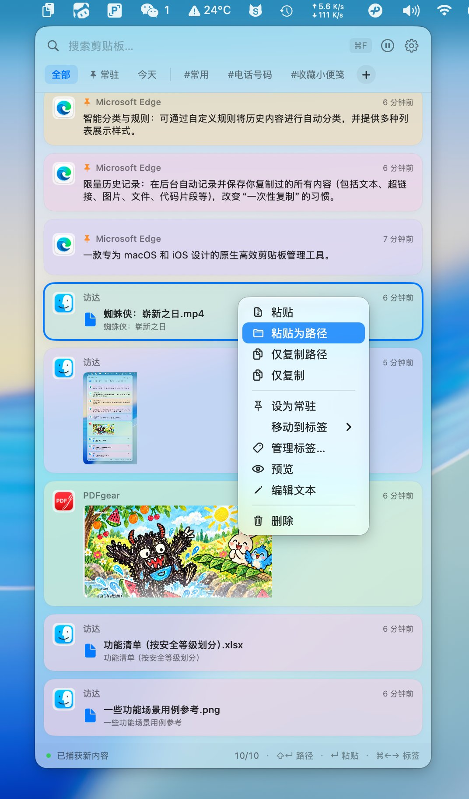
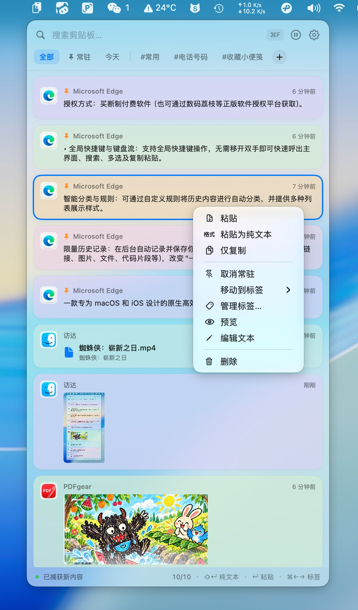
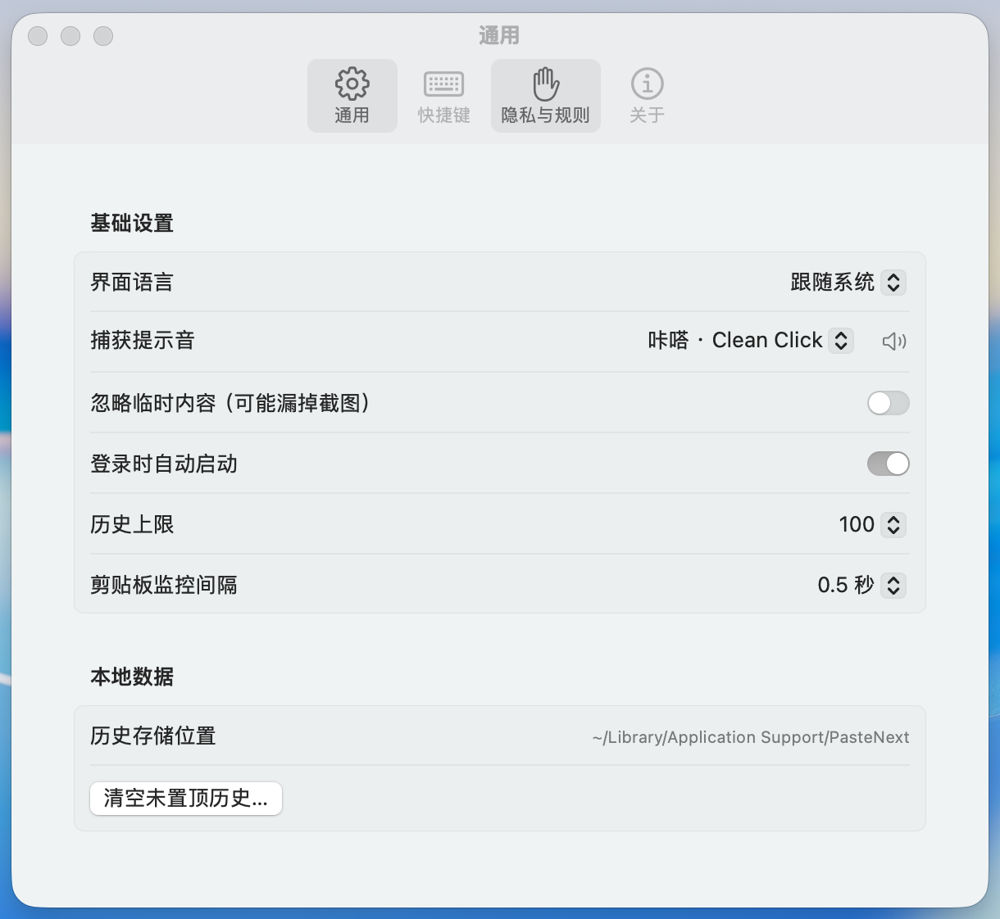
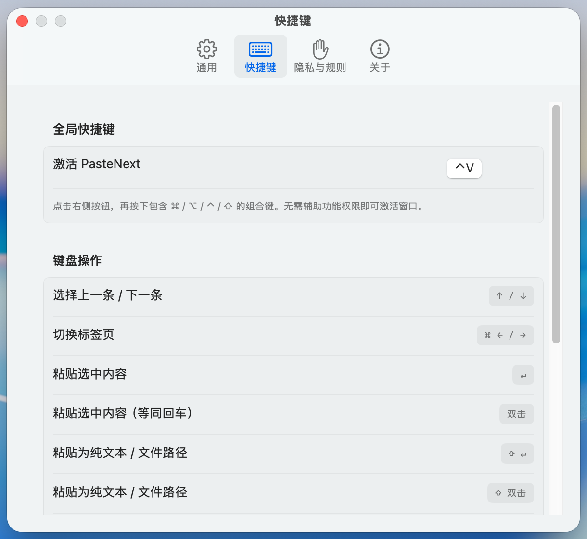
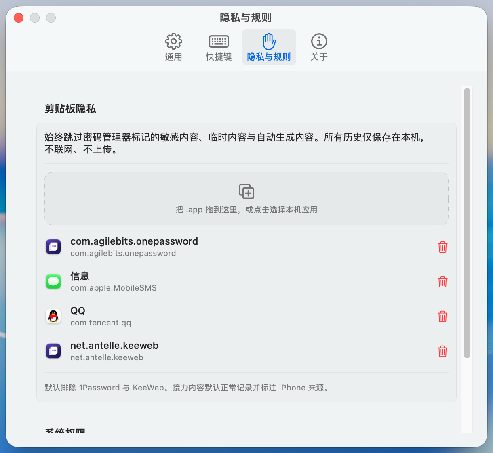
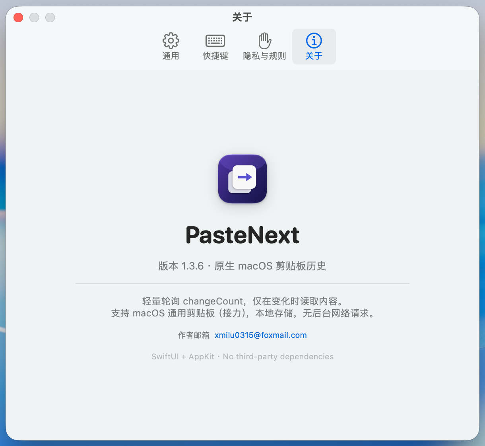
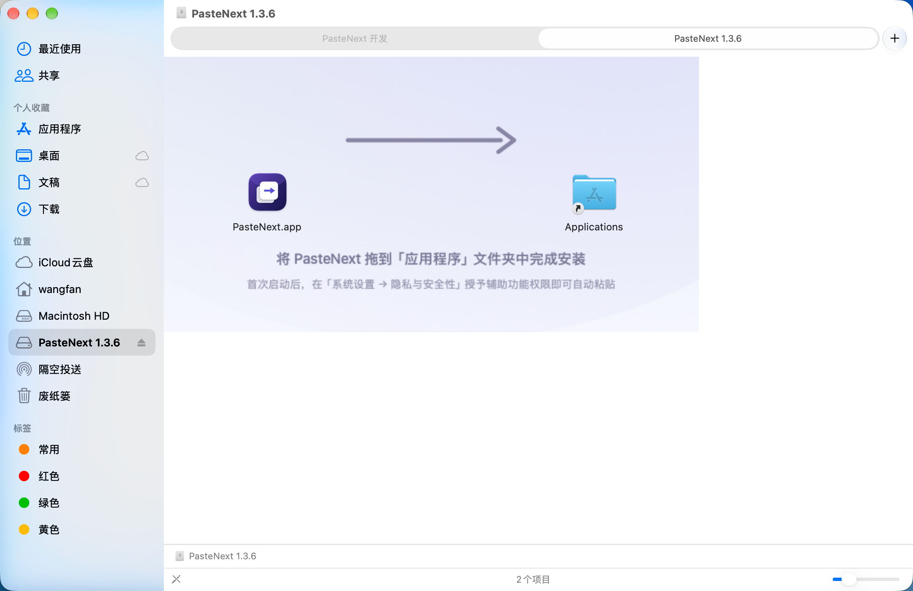

# PasteNext

> 原生 macOS 剪贴板历史管理器 · SwiftUI + AppKit · 零第三方依赖

PasteNext 是一款常驻菜单栏的 macOS 剪贴板历史工具。它轻量轮询 `NSPasteboard.changeCount`，**只在剪贴板真正变化时**才读取内容，自动把文本、代码、链接、颜色、图片和文件分类归档；配合全局快捷键即可秒级回取任何刚复制过的东西。

- **版本**：1.4.1
- **系统要求**：macOS 13 (Ventura) 及以上 · 通用二进制（Apple Silicon / Intel 均可运行）
- **技术栈**：Swift 5.9 / SwiftUI + AppKit / Swift Package Manager
- **依赖**：无第三方库（仅系统框架 AppKit、SwiftUI、Carbon、CoreGraphics）
- **作者邮箱**：xmilu0315@foxmail.com

---

## 下载安装

**[⬇ 下载最新版 DMG](https://github.com/xmilu0315/PasteNext/releases/latest)**

1. 双击 DMG，把 PasteNext 拖进「应用程序」
2. 首次打开若提示「无法验证开发者」，到 **系统设置 → 隐私与安全性** 点「仍要打开」
3. 首次使用请在 **系统设置 → 隐私与安全性** 授权两项：
   - **辅助功能** —— 回车 / 双击自动粘贴（向目标应用投递 ⌘V）
   - **完全磁盘访问** —— 粘贴其他应用容器内的文件（如微信收到的文件）

> 想从源码构建？见[构建与自测](#构建与自测)。

## 反馈与贡献

- 问题反馈：[Issues](https://github.com/xmilu0315/PasteNext/issues)
- 仓库地址：[github.com/xmilu0315/PasteNext](https://github.com/xmilu0315/PasteNext)
- 本项目以 [MIT](LICENSE) 许可开源，欢迎 fork 与 PR。

---

## 目录

- [下载安装](#下载安装)
- [反馈与贡献](#反馈与贡献)
- [界面截图](#界面截图)
- [功能总览](#功能总览)
- [交互速查](#交互速查)
- [技术设计](#技术设计)
  - [整体架构](#整体架构)
  - [剪贴板捕获管线](#剪贴板捕获管线)
  - [内容类型判定](#内容类型判定)
  - [图文混合内容模型](#图文混合内容模型)
  - [文件剪贴板的关键设计](#文件剪贴板的关键设计)
  - [历史存储](#历史存储)
  - [浮窗与窗口行为](#浮窗与窗口行为)
  - [粘贴投递](#粘贴投递)
  - [拖拽系统](#拖拽系统)
  - [多选与批量操作](#多选与批量操作)
  - [文件夹（长期存档）](#文件夹长期存档)
  - [隐私设计](#隐私设计)
  - [诊断日志](#诊断日志)
  - [国际化](#国际化)
- [工程结构](#工程结构)
- [构建与自测](#构建与自测)
- [支持作者 ☕](#支持作者-)
- [许可](#许可)

---

## 界面截图

| 主浮窗 | 右键菜单（文件） | 右键菜单（文本） |
| :---: | :---: | :---: |
|  |  |  |

| 设置 · 通用 | 设置 · 快捷键 | 设置 · 隐私与规则 |
| :---: | :---: | :---: |
|  |  |  |

| 设置 · 关于 | 安装包 |
| :---: | :---: |
|  |  |

---

## 功能总览

### 捕获与分类

| 能力 | 说明 |
|---|---|
| 变更检测 | 轮询 `changeCount`，仅在剪贴板变化时读取内容，默认间隔 0.5 秒可调 |
| 自动分类 | 文本 / 代码 / 链接 / 颜色 / 图片 / 文件 六类，卡片样式各不相同 |
| 多文件卡片 | 一次复制多个文件时逐行列出文件名，公共目录只在底部显示一次 |
| **图文混合** | 一条剪贴板可同时含图片与文字，两者都会保留并完整粘贴（见[图文混合内容模型](#图文混合内容模型)） |
| 来源标注 | 每张卡片显示来源应用图标与名称，时间以相对时间呈现 |
| 接力支持 | 支持 macOS 通用剪贴板（接力），并为来自 iPhone 的内容标注来源 |
| 捕获提示音 | 四种音效可选（咔嗒 / 轻触 / 气泡 / 静音），支持试听 |

### 浏览与检索

- 顶部搜索框实时过滤（`⌘F` 快速聚焦）。
- 分类页签：全部 / 常驻 / 今天 + 你自己的文件夹。
- 文件夹页签与内置页签之间有分隔线区分。
- 切换页签时，当前激活页签自动滚动到可见位置，不会被窗口边缘挡住。
- 底部状态栏显示内容数量统计与快捷键提示。
- 卡片底色按内容类型区分：文本近中性，链接 / 代码 / 颜色 / 图片 / 文件各有其色。

### 粘贴与复用

- `↵` 或 **双击**：粘贴选中内容。
- `⌘1` … `⌘9`：直接粘贴第 1-9 张卡片（**仅浮窗聚焦时生效**，不注册全局热键，避免与其他应用冲突）。
- `⇧↵` 或 **⇧双击**：粘贴为纯文本；**文件卡片则粘贴绝对路径**。
- 右键菜单**按内容类型定制**：文件卡片显示「粘贴为路径」，文本卡片显示「粘贴为纯文本」。
- 粘贴后自动隐藏浮窗并切回原应用。
- **粘贴即置顶**：粘贴过的卡片会浮到列表最前（成为下一个 ⌘1），剪贴板同时保存该内容 —— 你刚用过的东西，下次触手可及。

### 整理与批量

- **多选**：`⌘` 点击点选、`⇧` 点击区间连选，底栏实时显示已选数量。
- 批量操作：删除、置顶/取消常驻、上下移动、归档到文件夹。
- 拖拽排序、拖到文件夹上归档、拖进 Word 等外部应用。
- **文件夹 = 长期存档**：拖进文件夹的是一份**独立副本**，与「全部」里的原卡彻底解耦 —— 删原卡、清空历史、超出上限都不会影响它，只有手动删才会消失（详见[文件夹（长期存档）](#文件夹长期存档)）。

### 界面与系统集成

- 菜单栏常驻图标，捕获时原位轻微抖动反馈。
- 浮窗为 **non-activating panel**：不抢走你正在输入的窗口焦点。
- 浮窗可自由缩放，边缘与角落带 hover 高亮提示。
- 滚动条采用系统 overlay 样式：滚动时出现、停止后渐隐、拖柄纤细。
- 深浅色自适应，界面语言支持跟随系统 / 简体中文 / English。
- 可选「登录时自动启动」。

---

## 交互速查

### 全局

| 快捷键 | 作用 |
|---|---|
| `⌃V`（可自定义） | 激活 PasteNext 浮窗（**无需辅助功能权限**） |

### 浮窗内

| 快捷键 | 作用 |
|---|---|
| `↑` / `↓` | 选择上一条 / 下一条 |
| `⌘←` / `⌘→` | 切换页签 / 文件夹 |
| `↵` | 粘贴选中内容 |
| `⌘1` … `⌘9` | **原样粘贴**最近 1-9 条非常驻卡片（保留富文本与图片；仅浮窗聚焦时有效） |
| `⌘⇧1` … `⌘⇧9` | 粘贴对应卡片的**纯文本**（只取值） |
| **双击** | 粘贴选中内容（等同回车） |
| `⇧↵` | 粘贴为纯文本 / 文件路径 |
| **⇧双击** | 粘贴为纯文本 / 文件路径 |
| `Space` | 快速预览 |
| `⌘P` | 置顶 / 取消常驻选中内容 |
| `⌘↑` / `⌘↓` | 上移 / 下移选中内容 |
| `⌘⌫` | 删除选中内容 |
| `⌘R` | 重置界面状态 |
| `⌘W` | 关闭浮窗 |

> **关于系统权限**：全局激活快捷键（`⌃V`）走 Carbon 热键，**不需要任何权限**。
> 「回车 / 双击自动粘贴」需要**辅助功能权限**（向目标应用投递 `⌘V`）；
> 粘贴**其他应用容器内的文件**（如微信收到的文件）还需要**完全磁盘访问权限** ——
> 写进程写出的文件 URL 只携带自身进程的访问权，PasteNext 读不了的文件对任何目标应用都是死链。
> 两类权限的实时状态与一键授权入口在 **设置 → 隐私与规则 → 系统权限**。
> 未授权时应用会弹系统授权面板，并在状态栏给出明确提示，**不会静默失败**。

---

## 技术设计

### 整体架构

纯 AppKit 生命周期 + SwiftUI 视图层的混合架构，无任何第三方依赖。

```
┌──────────────────────────────────────────────────────────┐
│  PasteNextApp (SwiftUI App)                               │
│  └── AppDelegate (NSApplicationDelegateAdaptor)            │
│      ├── NSStatusItem  菜单栏图标 + 点击/右键菜单          │
│      ├── HotKeyManager  Carbon 全局热键（无权限依赖）      │
│      └── PanelController  NSPanel 浮窗                     │
└──────────────────────────────────────────────────────────┘
                          │
        ┌─────────────────┴─────────────────┐
        │                                   │
┌───────▼────────┐              ┌───────────▼──────────┐
│  AppState      │              │  ClipboardMonitor    │
│  @MainActor    │              │  changeCount 轮询     │
│  ObservableObj │◄─────────────┤  类型读取 + 分类       │
└───────┬────────┘              └──────────────────────┘
        │
┌───────▼────────┐
│  HistoryStore  │  JSON 持久化 + 图片文件 + 去重 + 裁剪
└────────────────┘
```

**状态管理**：`AppState` 是唯一的 `@MainActor ObservableObject` 中心状态，负责选中项、筛选、文件夹、面板显隐等 UI 状态；`HistoryStore` 单独持有历史数据。`ClipboardMonitor` 的 `objectWillChange` 被桥接到 `AppState`，保证 UI 在监控状态变化时同步刷新。

### 剪贴板捕获管线

`ClipboardMonitor.capture()` 的处理顺序经过刻意设计：

1. **过滤敏感类型**：命中 `org.nspasteboard.ConcealedType`、1Password、KeeWeb 的类型直接丢弃。
2. **过滤临时内容**（可选）：`org.nspasteboard.TransientType`、`AutoGeneratedType` 等，配置项「忽略临时内容」默认关闭以避免漏掉截图。
3. **来源识别**：优先读取 `org.nspasteboard.source` 声明的源应用，失败时回退到 `NSWorkspace.frontmostApplication`。
4. **排除列表**：命中用户在「隐私与规则」里排除的应用则跳过。
5. **自写忽略**：粘贴自身写回剪贴板时，通过 `ignoreNextWrite()` 记录 `changeCount` 避免自捕获。
6. **读取内容**（三条通道互相独立，可同时成立）：
   - 文件：先 `readObjects(forClasses: [NSURL.self])`，再用 `.fileURL` / `.URL` / `text/uri-list` / `NSFilenamesPboardType` 多路兜底，最后扫 Qt 私有 MIME blob。
   - 图片：`.tiff` / `.png` / `public.jpeg` / `public.heic` / `public.webp` / GIF / BMP；失败再依次尝试 RTF 内嵌图、WebArchive 子资源、HTML 内 ``。
   - 文本：`.string`。
7. **去抖**：检测到变化后延迟 60ms 合并「先清空再写入」的多步序列，避免抓到中间态。

### 内容类型判定

`ClipKind` 只决定**图标、页签归属和卡片底色**，不再决定「这条内容有什么」。`ClipClassifier` 依据内容特征判定主类型：

| 顺序 | 判定 | 规则 |
|---|---|---|
| 1 | `.files` | 剪贴板存在文件 URL |
| 2 | `.image` | 存在图片数据或图片文件（截图工具临时文件除外，见下） |
| 3 | `.color` | 匹配 `#RRGGBB` / `#RRGGBBAA` |
| 4 | `.link` | `http` / `https` 且含 host、不含换行 |
| 5 | `.code` | 含换行且命中 `func / class / struct / import / def / return / const / let / var / public / private / #include / => / </ / {` 等特征 |
| 6 | `.text` | 其余 |

### 图文混合内容模型

这是本项目踩坑最深的一块。核心事实：**一条剪贴板可以同时包含图片、文字和文件**，而 macOS 各家应用写入图片的方式完全不同——

| 来源 | 图片藏在哪 |
|---|---|
| 微信输入框 | 临时目录下的 PNG 文件 URL + 纯文本 |
| 浏览器（WebKit） | `com.apple.flat-rtfd` / `com.apple.webarchive`，**没有独立图片 flavor** |
| 浏览器（Chromium） | `public.html` 里的 ``，src 常为相对路径 |
| Word / TextEdit | `public.rtf` 里的 `\pngblip` 十六进制块 |

因此模型设计成三条不变式：

- **`text` 永远是真实文本**，绝不掺入生成物。纯图片卡片 `text` 为空，由 `imageSize`（如 `"800×600"`）负责描述与去重。
- **`captionText` 独立于 `kind`**：图文卡片即使主类型是 `.image`，也能取回自己的文字。
- **渲染与粘贴都输出全部内容**：卡片同时画图和字；粘贴时同时写图片 flavor 和 `.string`，富文本目标（如微信输入框）能收到完整内容。

图片提取按顺序尝试六条路径，任一条成功即止：独立 flavor → 逐 flavor 兜底 → 文件 URL → 任意 blob 特征码扫描 → RTF 十六进制 → WebArchive → HTML（`data:` / `file://` / 按源页面解析的相对路径）。**远程 URL 一律不抓取**，以保持「零网络请求」的承诺。

> 早期版本曾用 `text.hasPrefix("图片")` 之类的前缀启发式区分「真实图注」和「生成描述」，结果把「图片后面的文字」误判为描述、清掉了图注。现在完全不需要这种猜测。

### 文件剪贴板的关键设计

核心矛盾在于：**访达复制文件时，剪贴板同时写入「文件 URL」和「文件图标的 TIFF 预览」**。

- **文件 URL 优先**：只要存在文件 URL，即判定为 `.files`。
- **截图工具例外**：若文件全部是图片、且来自临时目录（`/var/folders/`、`/tmp/`、`/temp/`、`/TemporaryItems/`、`Screenshot`）或来自 PixPin 等已知截图工具，则仍按图片处理——因为那些临时文件很快会被清理，只存路径会导致内容失效。
- **写入用纯数据，不用 `NSURL` 对象**：`NSPasteboard.writeObjects([NSURL])` 并不是写入一个普通 URL，而是写入一个**文件承诺（file promise + sandbox extension）**，接收方必须回头找写入进程兑现。PasteNext 是 ad-hoc 签名且非沙箱，该承诺永远无法被消费——访达因此拒绝粘贴并播放「空剪贴板」提示音。改为访达原生写法：`setPropertyList(paths, forType: NSFilenamesPboardType)` + `setString(url, forType: .fileURL)`，多文件再补 `text/uri-list`。
- **写入前校验，绝不留空剪贴板**：任何一条写入失败都会回退到纯文本，不会出现「清空了却什么都没写进去」。
- **去重带路径与尺寸**：去重键为 `kind + text + imageSize + filePaths`。
- **历史自动纠正**：启动时把历史中 `kind == .image` 但路径并非图片的旧条目回填为 `.files`；并把旧版写成文本的「截图 · 800×600」描述迁入 `imageSize`。
- **格式无关**：判定依据是「剪贴板里有没有文件 URL」，而非扩展名白名单。已用 42 种格式（xlsx/docx/pptx/pdf/mp4/mov/zip/rar/7z/png/jpg/gif/svg/csv/py/dmg/pkg/app/ttf/psd/ai/pages/numbers/iso/epub/mobi/rtf/wav/mp3/sql/db …）回归验证，**42/42 全部正确识别**。

### 历史存储

- 路径：`~/Library/Application Support/PasteNext/`
  - `history.json`：条目元数据（`Codable`）
  - `Images/`：图片条目落盘的 PNG
  - `Fragments/`：捕获时存档的原始 HTML（粘贴时原样重放，保留源文档的顺序与格式）
- 写入策略：防抖 0.35s 后原子写（`.atomic`），避免高频捕获时的 IO 抖动。
- 裁剪：只淘汰滚动历史，**常驻条目与文件夹里的存档副本永不参与淘汰**。
- 图片缓存：`NSCache` 限制 40 张，避免内存膨胀。
- **排序**：常驻条目置顶，其余按复制时间新的在前。**重复复制同一内容会把它移回顶部**（早期版本只刷新时间戳不移位，导致卡片声称「刚刚」却停在原处）。
- 历史上限、轮询间隔、排除列表、界面语言、快捷键等均存于 `UserDefaults`。

### 浮窗与窗口行为

- 面板样式：`[.borderless, .fullSizeContentView, .nonactivatingPanel, .resizable]`，`level = .floating`。
- **non-activating** 是关键：浮窗出现时不会抢走你正在输入的浏览器/编辑器焦点。为此粘贴时需要显式把目标应用切回前台（见「粘贴投递」）。
- 缩放：右缘 / 下缘 / 右下角各有独立 `NSView` 热区（10pt / 10pt / 24pt），带 tracking area，hover 时显示高亮并切换为对应的缩放光标。
- 尺寸与位置持久化，`windowDidResize` 落盘。

### 粘贴投递

`PasteService.copy(_:image:monitor:paste:plainText:pasteboard:)` 的执行顺序经过实测校准：

1. **写入剪贴板**：按内容类型分派——文件写 `NSFilenamesPboardType` + `public.file-url` 纯数据；图片写 TIFF（必要时回退 PNG）；文字写 `.string`。三者可同时存在，全部写入。
2. 通过 `NSWorkspace.didActivateApplicationNotification` **持续记录**「最近一个非本应用的前台应用」（`AppState.pasteTarget`），而非在面板弹出的瞬间采样——因为点击菜单栏图标时应用自身可能已成为前台，瞬时采样会拿到自己。
3. `activate()` 目标应用，**非阻塞轮询**等待它真正成为 `frontmostApplication`（20 × 50ms）。
4. 确认目标在前台后，才通过 `CGEvent` 发送 `⌘V`。
5. 若辅助功能权限缺失：**不发送按键、不清空剪贴板**，状态栏明确提示并弹出系统授权面板。

**完全磁盘访问权限**与文件粘贴的关系：粘贴文件时 PasteNext 只把文件 URL 写回剪贴板，并不读取文件本身 —— 但这个 URL 携带的是 **PasteNext 自己的访问权**。因此对微信等应用容器内的文件，没有完全磁盘访问就等于把死链交给目标应用。写入前会逐一检查路径可读性，不可读时记录诊断日志并提示。

应用采用固定 designated requirement（`identifier "com.pastenext.app"`）签名，因此**重新构建不会使已授予的系统权限失效**。

### 拖拽系统

- 内部拖拽：自定义 `PasteDragType`（`public.pastenext.card` / `public.pastenext.tab`）在卡片与页签之间传递。
- 外部拖拽：卡片同时注册 `public.png` 与 `public.file-url`，可直接拖入 Word、邮件等应用。
- 文件卡片只注册 `public.file-url`，避免被误当成图片贴进去。

### 多选与批量操作

- `AppState.selectedIDs` 保存选中集合，`selectionAnchor` 记录连选锚点。
- `⌘` 点击：切换单条；`⇧` 点击：以锚点为基准做区间连选。
- 批量操作统一走 `targetIDs(including:)`：右键点在已选中的卡片上时作用于整个集合，否则只作用于该条。

### 文件夹（长期存档）

剪贴板历史是**滚动**的：有新内容进来，旧的会被上限淘汰；清空历史则全部消失。文件夹解决的是另一半需求 —— **把某条内容永久留下来**。

**语义：归档 = 复制一份独立副本。**

把卡片拖到文件夹标签上（或用右键「归档到文件夹」），会创建一条**副本**：

| | 历史 | 文件夹里的副本 |
|---|---|---|
| 存放位置 | 滚动记录 | 独立记录（`folder` 字段非空） |
| 数量上限 | 受「历史上限」约束 | **无上限** |
| 时间淘汰 | 超出上限即淘汰 | **永不淘汰** |
| 清空历史 | 被清空 | **不受影响** |
| 文件归属 | 自己的图片 / HTML 片段 | **归档时复制出的独立文件** |
| 删除原卡 | 原卡消失 | **副本完好** |
| 如何删除 | ⌘⌫ / 右键删除 | 只能在文件夹内手动删除 |

关键实现：

- **副本拥有自己的文件** —— 归档时把图片与 HTML 片段**复制**成新文件名，所以删除原卡（连带删除它的文件）不会让副本变成空壳。
- **去重按内容** —— 同一内容重复归档到同一文件夹是空操作，不会产生重复卡片。
- **与历史彻底分流** —— `filteredItems` 在文件夹视图读 `savedItems(in:)`，在历史视图读 `historyItems`，两者不交叉；归档也不会写入历史。
- **老数据自动迁移** —— 旧版本的「标签」会一次性迁移成同名文件夹（卡片变成该文件夹下的存档副本）。

> 一句话：**「全部」是最近复制过的，文件夹是你决定留下的。**

### 隐私设计

- 密码管理器标记的敏感内容（`ConcealedType`）永不捕获。
- 1Password 与 KeeWeb 默认排除；用户可在设置中**拖拽 `.app` 文件**或点击选择本机应用来追加排除项，无需手填 Bundle ID。
- 全部历史仅保存在本机，**不上传、无任何遥测**。
- 唯一的网络行为：当你在浏览器复制「图文」时，剪贴板里只有图片的网址，PasteNext 会在你复制的瞬间获取那张图片本身（**设置 → 隐私与规则** 可关闭）。关闭后浏览器图文仍可记录文字，只是没有图片。
- 接力内容默认正常记录并标注 iPhone 来源。

### 诊断日志

捕获与粘贴都会做一系列判断——图片从哪来、文字是否存活、什么真正落进了剪贴板。这些在真实机器上不可见，所以写入：

```
~/Library/Logs/PasteNext/pastenext.log
```

每行一个事件，形如 `capture.done kind=image hasText=true hasImage=true imageFrom=webarchive imageSize=800×600`。排障时先看这个文件，比复述现象高效得多。

自检运行时还会打印权限状态：`permissions: accessibility=true fullDiskAccess=false` —— 权限问题一眼可见。

### 国际化

`Localizable.swift` 提供 `L("中文", "English")` 辅助函数，界面语言可跟随系统或手动指定。

---

## 工程结构

```
PasteNext/
├── Package.swift                  SPM 包定义（macOS 13+）
├── README.md                      本文档
├── LICENSE                        MIT
├── Resources/
│   ├── Info.plist                 应用配置（LSUIElement、版本、图标）
│   ├── AppIcon.icns               应用图标（矢量母版经 make-icon.swift 生成）
│   ├── AppIcon.svg                图标矢量母版
│   ├── AppIcon-1024.png           图标母版位图
│   ├── donate-wechat.png          捐赠收款码（应用内「关于」页使用）
│   └── donate-alipay.png          捐赠收款码
│       （dmg-background.png 由 make-dmg-background.swift 在构建时生成，不入库）
├── screenshots/                   README 与上架用界面截图
├── Sources/PasteNext/
│   ├── PasteNextApp.swift         入口、AppDelegate、菜单栏、调试开关
│   ├── AppState.swift             中心状态与业务逻辑
│   ├── ClipboardMonitor.swift     剪贴板捕获管线
│   ├── HistoryStore.swift         历史持久化、去重、排序、迁移
│   ├── Models.swift               数据模型与内容分类、配色
│   ├── ContentView.swift          浮窗主界面
│   ├── ClipCard.swift             卡片视图
│   ├── PanelController.swift      浮窗控制器与面板内快捷键
│   ├── ResizeHandles.swift        自定义缩放热区
│   ├── OverlayScrollerConfigurator.swift  overlay 滚动条
│   ├── PasteService.swift         剪贴板写入与粘贴投递
│   ├── Permissions.swift          系统权限检测（辅助功能 / 完全磁盘访问）
│   ├── HotKeyManager.swift        Carbon 全局热键
│   ├── DragSupport.swift          拖拽数据提供者
│   ├── FolderViews.swift          文件夹视图（新建 / 重命名 / 归档选择器）
│   ├── PreviewEditViews.swift     预览 / 编辑
│   ├── SettingsView.swift         设置面板
│   ├── CaptureSound.swift         捕获提示音
│   ├── Diagnostics.swift          诊断日志
│   ├── Localizable.swift          中英文案
│   ├── SelfTest.swift             自检用例
│   └── AboutSnapshotView.swift    仅 DEBUG：关于页快照渲染
├── scripts/
│   ├── build-app.sh               release 构建（双架构）+ 签名 + 打包 DMG
│   ├── make-icon.swift            矢量应用图标生成
│   ├── make-dmg-background.swift   DMG 拖拽引导底图生成
│   ├── make-donation-qr.swift      捐赠收款码裁切与统一样式
│   └── dmg/                        DMG 打包与布局校验工具
└── Dist/PasteNext-1.4.1.dmg       可分发安装镜像（DMG）
```

> 上架素材（海报、文案）与海报生成脚本存放在独立工作区 `PasteNext 营销/`，不纳入本仓库。

---

## 构建与自测

```bash
# 调试构建
swift build

# 运行内置自检（约 160 条断言，运行时打印实际通过数）
.build/debug/PasteNext --self-test

# release 构建 + 临时签名 + 打包为 DMG（通用二进制）
./scripts/build-app.sh
# 产物：Dist/PasteNext-1.4.1.dmg
# DMG 内含 PasteNext.app、/Applications 软链接与安装说明

# 重新生成矢量应用图标
swift scripts/make-icon.swift Resources/AppIcon-1024.png

# 重新生成捐赠收款码
swift scripts/make-donation-qr.swift "$(pwd)" <微信码路径> <支付宝码路径>
```

自检覆盖：内容分类、持久化往返、截图与文件剪贴板识别、访达文件复制保持为文件、纯路径剪贴板捕获、文件绝对路径表示、`⌘1…⌘9` 键码映射、配色六类两两可区分、**8 种剪贴板形态的完整矩阵**（纯图 / 纯文 / 图文单 item / 图文双 item / HTML / PNG flavor / RTF 内嵌图 / WebArchive）以及粘贴侧的图文双写。

---

## 支持作者 ☕

PasteNext 是我一个人从零做出来的：没有团队、没有投资、没有订阅制，**所有更新永久免费**。

如果你觉得它省了你一点时间，**欢迎请我喝杯咖啡** —— 这笔钱会直接变成下一个功能（比如 iCloud 同步、剪贴板分类规则、全局快捷键自定义面板）的开发时间。

| 微信 | 支付宝 |
| :---: | :---: |
|  |  |

**扫码方式**：应用内 **设置 → 关于 → 鼠标悬停在「支持作者」上**即可展开这两张收款码。

也可以直接搜索微信号 **迷彩小懒猪（\*帆）** 微信支付，或使用支付宝扫码。

> 每一笔捐赠都会收到一句谢谢 ☕，这比数字本身更让人开心。

---

## 许可

MIT License，详见 [LICENSE](LICENSE)。

作者：xmilu0315@foxmail.com
